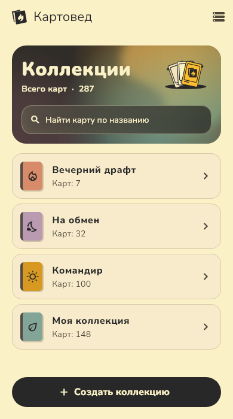
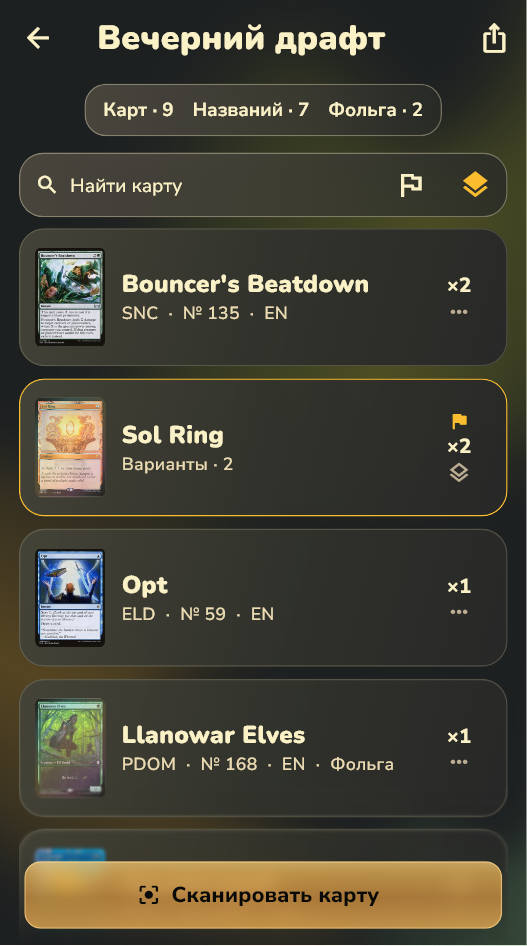
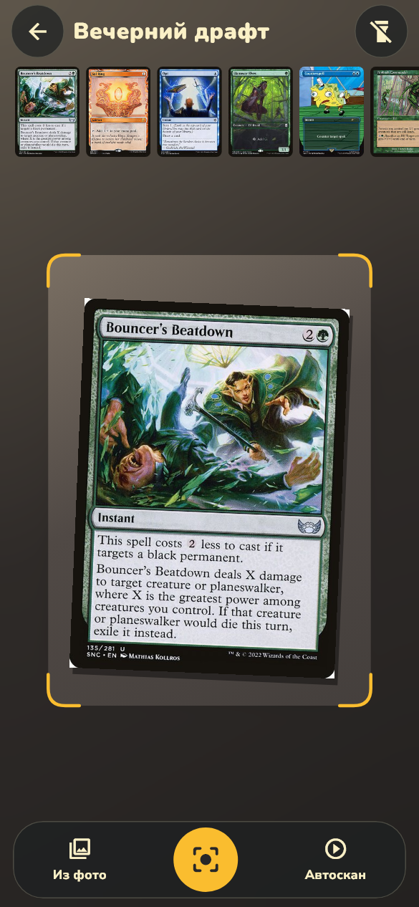
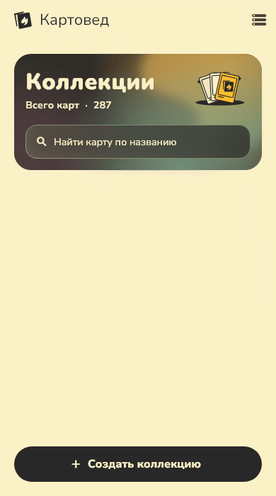
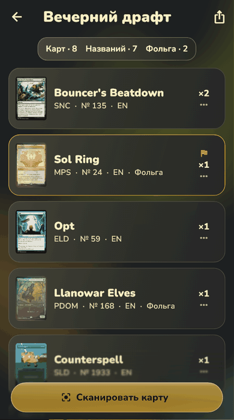
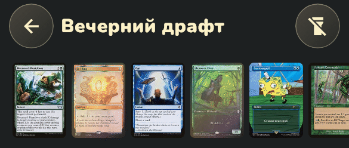

# Картовед

Автономный сканер бумажных карт Magic для Android. Создайте коллекцию, откройте её и нажмите «Сканировать карту». Включите «Автоскан» и показывайте карты по одной. При успешной записи раздаётся короткий сигнал. Для второго экземпляра той же карты нажмите затвор.

## Интерфейс

Чтобы перенести библиотеку на другой телефон, откройте «Резервная копия» вверху списка коллекций и нажмите «Сохранить в файл». Перенесите JSON на другой Android, выберите «Восстановить из файла», сверьте количество коллекций и карт и нажмите «Заменить коллекции». Файл сохраняет историю сканирования, издания, языки, фольгу, флажки и очередь проверки. Перенос работает без интернета.

В меню камеры откройте «Настройки стопки», чтобы задать язык и код издания до выхода из сканера. Можно оставить любое поле в режиме «Авто». Стрелка возле ленты отменяет последнее добавление текущего сеанса.

Янтарная точка на миниатюре означает, что карту нужно проверить. Нажмите миниатюру или «Проверить» в сканере либо коллекции, сравните варианты и подтвердите нужный. Очередь сохраняется между запусками. Счётчики коллекции и экспорт Moxfield учитывают подтверждённые экземпляры.

| Коллекции и поиск | Открытая коллекция | Сканер |
| :---: | :---: | :---: |
|  |  |  |

<details>
<summary>Посмотреть прокрутку коллекции, обложку и миниатюры</summary>





</details>

Снимки в полном размере и пояснения к экранам — в [галерее интерфейса](docs/README.md).

«Найти карту» ищет в открытой коллекции по английскому или русскому названию. Например, «Выбор» и Opt находят одну карту. Флажок рядом со строкой поиска оставляет только отмеченные позиции. Кнопка со слоями складывает варианты с одинаковым названием и показывает их общее количество.

Нажмите на строку, чтобы открыть крупное изображение. Если вариантов несколько, выберите выпуск, язык и покрытие под изображением, затем измените количество кнопками «−» и «+». Крупное изображение сохраняется на телефоне после первой загрузки. Пока оно недоступно, показывается сохранённая миниатюра.

В открытой коллекции смахните карту влево или нажмите на многоточие возле количества. Флажок отмечает конкретное издание, язык и покрытие в этой коллекции. Кнопка «Убрать» удаляет все экземпляры выбранной позиции. Нажмите «Отменить», чтобы вернуть их вместе с флажком.

Верхняя лента показывает последние добавления. Нажмите миниатюру, чтобы уточнить издание и язык. Изображение берётся из Scryfall по идентификатору издания и стороне, сохраняется на телефоне и доступно при следующих просмотрах без интернета. Заранее скачать миниатюры можно через «База карт → Миниатюры выпуска офлайн». При отсутствии изображения в кэше и сети в ленте отображается название карты.

Значок экспорта открывает системный выбор файла. Если в коллекции есть флажки, можно сохранить всю коллекцию или только отмеченные позиции. В Moxfield выберите формат Moxfield CSV. Для каждого сочетания выпуска, номера, языка и покрытия записывается своё количество. Поиск и группировка на экране влияют только на просмотр.

Картовед читает напечатанный код языка и текст с помощью встроенных Tesseract и ML Kit. OCR настроен на латиницу и кириллицу. Для остальных письменностей помогает печатный код, если он присутствует. При неопределённом языке в CSV остаётся пустое поле. При одинаковом рисунке нескольких выпусков проверьте издание в ленте перед экспортом.

## Установка и запуск

Состояние коллекций и режима сканирования управляется через Cubit из flutter_bloc.

На главном экране можно искать карты по английскому или русскому названию без сети. Результаты объединены по названию. При выборе карты открывается список изданий с языком и коллекционным номером. Русские названия и варианты покрытия берутся из набора Scryfall All Cards при подготовке каталога.

Если найденное издание выпускалось только в фольге, сканер отметит фольгу автоматически. Для карты с несколькими вариантами покрытия поставьте отметку «Фольга» в результате распознавания или нажмите последнюю миниатюру в сканере. Обычные и фольгированные экземпляры учитываются отдельно в коллекции и в CSV.

Проект использует Flutter 3.50, Android SDK и JDK 21. Каталог уже входит в APK. Первый запуск и распознавание работают без учётной записи и подключения к сети. Для запуска на телефоне:

```sh
flutter pub get
flutter run
```

Сборка для устройств ARM64:

```sh
flutter build apk --release --target-platform android-arm64
```

Готовый подписанный APK для ARM64 можно скачать на [странице выпусков](https://github.com/Hecatoncheir/kartoved/releases). При отправке тега вида `v0.2.0` GitHub Actions сверяет версию с pubspec, извлекает соответствующий раздел CHANGELOG.md, собирает и проверяет APK и прикладывает его к выпуску. CI использует постоянный ключ из секретов репозитория. При локальной сборке для разработки по умолчанию используется отладочная подпись.

## Каталог

Кнопка базы в правом верхнем углу проверяет обновления в этом репозитории. Телефон получает номер коммита каталога, читает манифест по этому коммиту и скачивает изменившиеся файлы. Перед переключением версии приложение проверяет размер, SHA-256 и количество иллюстраций в SQLite. При обрыве загрузки остаётся доступна установленная версия. Коллекция пользователя хранится отдельно.

GitHub Actions ежедневно проверяет, вышел ли новый комплект ManaVault. При обновлении скрипт сверяет хеши, пересобирает SQLite, проверяет распознавание контрольной карты и публикует полученные файлы. Эту проверку можно также запустить вручную в разделе Actions.

Чтобы самостоятельно подготовить каталог, возьмите версию из тега `scanner-bundle-<версия>` ManaVault. Из корня проекта запустите:

```sh
python tool/prepare_catalog.py retrain-20261117T065312257582Z
```

Замените аргумент новой версией и опубликуйте изменения `assets/oracle/` в ветке `main`. Обновление станет доступным уже установленным приложениям. Скрипт проверяет хеши поставщика и подготавливает SQLite с порядком иллюстраций из поисковой модели.

## Распознавание

Картовед выполняет два прохода детектора, выравнивает изображение и ищет иллюстрацию нативным ONNX Runtime в отдельном изоляте Dart. При слабом совпадении предлагает повторить снимок. Если несколько изданий используют одну иллюстрацию, выпуск и язык выбирает пользователь. Снимки обрабатываются на устройстве.

```sh
flutter analyze
flutter test test
dart run tool/check_photo.dart assets/oracle путь/к/снимку.jpg
```

Android-тест в GitHub Actions отключает сеть эмулятора и проверяет распознавание контрольной карты, поиск её выпуска, запись в коллекцию и установку обновления. Также проверяются русский и английский отпечатки одной карты, язык экспорта и распознавание кадра NV21. Для воспроизводимости уменьшенный контрольный снимок хранится в тестах. [Bouncer’s Beatdown, художник Mathias Kollros](https://scryfall.com/card/snc/135/bouncers-beatdown).

## Источники

- [Модели Oracle и формат комплекта](https://github.com/cfbender/oracle). Исходный код Oracle распространяется по MPL-2.0. [Комплекты ManaVault](https://github.com/cfbender/manavault/releases).
- Метаданные карт происходят из [Scryfall](https://scryfall.com/). Magic: The Gathering и иллюстрации карт принадлежат соответствующим правообладателям. Картовед — независимый проект.
- [Маска камеры](https://github.com/Hecatoncheir/camera_view_mask), [палитра Gruvbox](https://github.com/morhetz/gruvbox), шрифты Nunito и Nunito Sans под SIL OFL. Тексты лицензий находятся в `assets/licenses/`.
