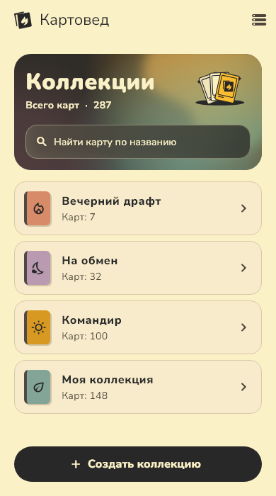
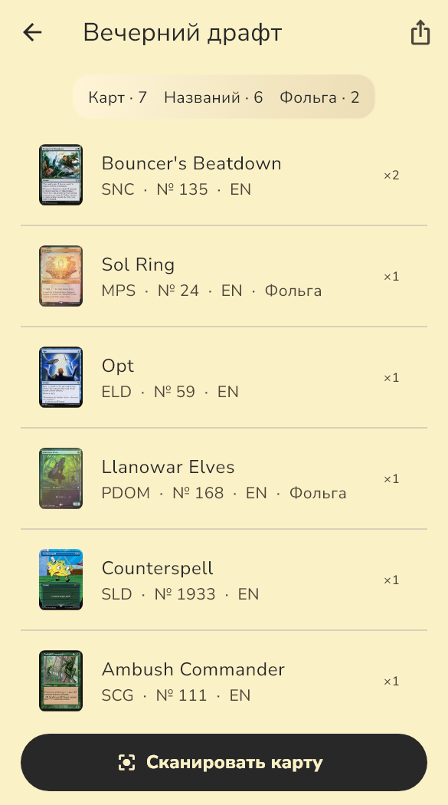
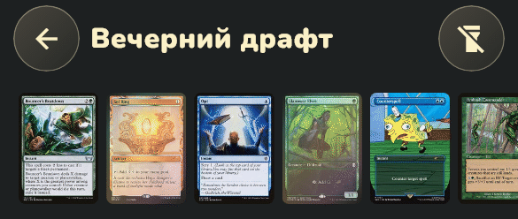

# Интерфейс Картоведа

Снимки и анимации показывают интерфейс Flutter версии 0.3.0 с демонстрационной коллекцией.

## Коллекции

На обложке видно общее количество карт. Строка поиска открывает автономный каталог с английскими и русскими названиями.

Появление коллекций и движение подсветки

## Открытая коллекция

В «Вечернем драфте» семь экземпляров, шесть разных названий и две фольгированные карты. Кнопка внизу открывает сканер, а кнопка в правом верхнем углу сохраняет CSV для Moxfield.

## Камера

Распознанные карты появляются в верхней ленте слева. Касание миниатюры открывает выбор издания и покрытия. Для кадра в видоискателе использован контрольный снимок Bouncer’s Beatdown.

Наклон миниатюр при касании

