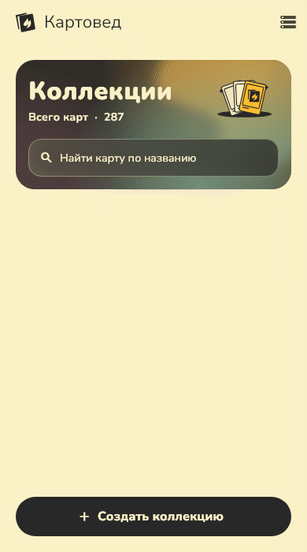
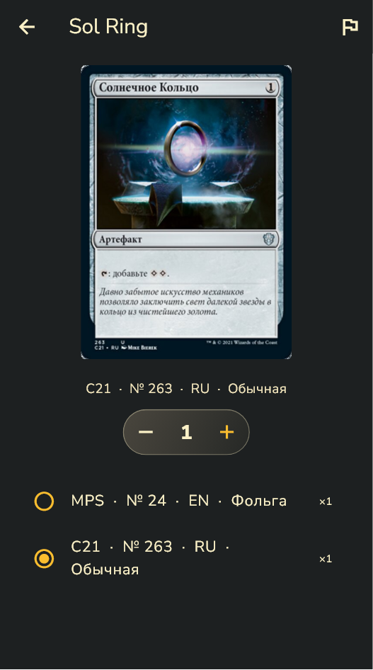

# Интерфейс Картоведа

Снимки и анимации показывают интерфейс Flutter с демонстрационными коллекциями.

## Коллекции

На обложке видно общее количество карт. Строка поиска открывает автономный каталог с английскими и русскими названиями.

Появление коллекций и движение подсветки

## Открытая коллекция

Кнопка со слоями включает группировку по названию. В «Вечернем драфте» две карты Sol Ring отображаются одной строкой «×2». Нажмите на неё, чтобы рассмотреть английскую фольгированную или русскую обычную карту и изменить количество выбранного варианта.

Как карты проходят под стеклянной кнопкой сканера

Прокрутка до последней карты и действия по свайпу в версии 0.4.0

## Камера

Распознанные карты появляются в верхней ленте слева. Касание миниатюры открывает выбор издания и покрытия. Для кадра в видоискателе использован контрольный снимок Bouncer’s Beatdown.

Наклон миниатюр при касании

