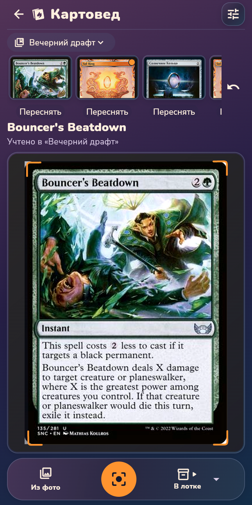
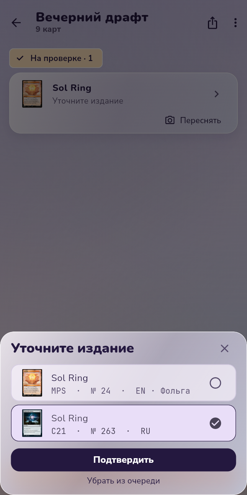
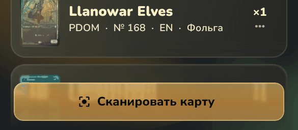
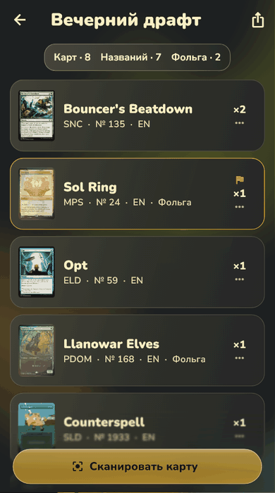

# Интерфейс Картоведа

Снимки сделаны в браузерной версии Картоведа 1.3.0 с демонстрационными коллекциями.

## Коллекции

В библиотеке видно число карт в каждом альбоме. Строка поиска открывает автономный каталог с английскими и русскими названиями. Плашка «На проверке» показывает число спорных снимков во всех альбомах.

## Открытая коллекция

Кнопка со слоями включает группировку по названию. В «Вечернем драфте» две карты Sol Ring отображаются одной строкой «×2». Нажмите на неё, чтобы рассмотреть английскую фольгированную или русскую обычную карту и изменить количество выбранного варианта.

## Камера

Распознанные карты появляются в верхней ленте слева. Нажмите на миниатюру, чтобы уточнить издание и покрытие. В видоискателе показан контрольный кадр с Bouncer’s Beatdown.

В меню сканера можно задать код выпуска и язык всей стопки. Янтарная точка отмечает спорный снимок. В альбоме откройте «На проверке» и нажмите на карту, чтобы выбрать издание и подтвердить снимок. Очередь сохраняется после перезапуска.

Анимации прежних версий

